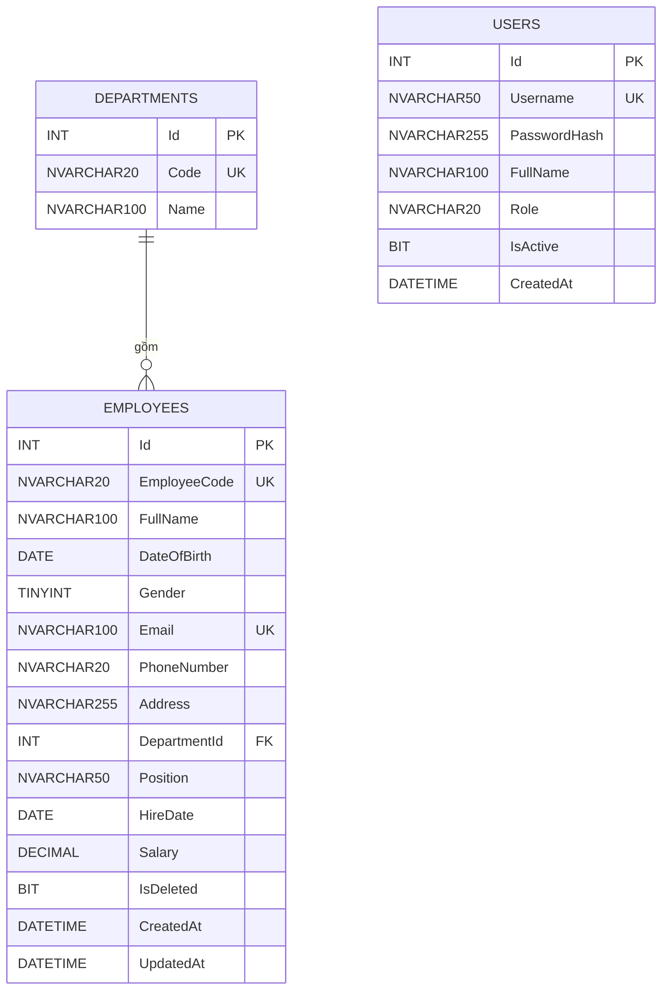

# Employee Management System

Hệ thống quản lý nhân sự: quản lý nhân viên, phòng ban và tài khoản đăng nhập.

## Mục lục

- [Công nghệ sử dụng](#công-nghệ-sử-dụng)
- [Kiến trúc phân tầng](#kiến-trúc-phân-tầng)
- [Cấu trúc thư mục](#cấu-trúc-thư-mục)
- [Thiết kế cơ sở dữ liệu](#thiết-kế-cơ-sở-dữ-liệu)
- [Danh sách API](#danh-sách-api)
- [Hướng dẫn cài đặt](#hướng-dẫn-cài-đặt)
- [Quy ước code](#quy-ước-code)
- [Quy trình Git](#quy-trình-git)

## Công nghệ sử dụng

| Thành phần | Công nghệ |
|------------|-----------|
| Backend | ASP.NET Core Web API (.NET 8) |
| ORM | Entity Framework Core |
| Cơ sở dữ liệu | SQL Server |
| Xác thực | JWT Bearer (mật khẩu được băm, không lưu dạng thô) |
| Tài liệu API | Swagger / OpenAPI |

> Cập nhật lại bảng trên nếu dự án dùng phiên bản hoặc công nghệ khác.

## Kiến trúc phân tầng

Solution được chia thành các tầng rõ ràng, mỗi tầng chỉ gọi tầng ngay bên dưới nó:

```
Client (Web / Postman)
        │  HTTP request
        ▼
┌─────────────────┐
│   Controller    │  Nhận request, validate đầu vào, trả response
└────────┬────────┘
         ▼
┌─────────────────┐
│    Service      │  Xử lý nghiệp vụ (business logic)
└────────┬────────┘
         ▼
┌─────────────────┐
│   Repository    │  Truy vấn / thao tác dữ liệu
└────────┬────────┘
         ▼
┌─────────────────┐
│    DbContext    │  EF Core, ánh xạ tới SQL Server
└─────────────────┘
```

| Tầng | Trách nhiệm | Không được làm |
|------|-------------|----------------|
| **Controller** | Định tuyến, nhận/trả DTO, mã trạng thái HTTP | Viết nghiệp vụ, truy cập DbContext trực tiếp |
| **Service** | Quy tắc nghiệp vụ (ví dụ: kiểm tra trùng mã nhân viên, ngày sinh phải trong quá khứ, lương > 0) | Làm việc với HttpContext, viết truy vấn |
| **Repository** | CRUD, truy vấn LINQ, phân trang | Chứa nghiệp vụ |
| **DbContext** | Cấu hình entity, quan hệ, migration | Chứa logic xử lý |

## Cấu trúc thư mục

```
EmployeeManagement/
├── EmployeeManagement.sln
├── docs/                          # Tài liệu thiết kế (ERD, API, wireframe)
├── src/
│   └── EmployeeManagement.Api/
│       ├── Controllers/           # EmployeesController, DepartmentsController, AuthController
│       ├── Services/
│       │   ├── Interfaces/        # IEmployeeService, ...
│       │   └── Implementations/   # EmployeeService, ...
│       ├── Repositories/
│       │   ├── Interfaces/        # IEmployeeRepository, ...
│       │   └── Implementations/   # EmployeeRepository, ...
│       ├── Data/
│       │   ├── AppDbContext.cs
│       │   └── Migrations/
│       ├── Models/                # Entity: User, Employee, Department
│       ├── DTOs/                  # Request / Response
│       ├── Program.cs
│       └── appsettings.json
└── README.md
```

> Điều chỉnh cho khớp với cấu trúc thực tế của solution.

## Thiết kế cơ sở dữ liệu

### Sơ đồ ERD



### Mô tả các bảng

- **Users**: tài khoản đăng nhập. `Role` nhận giá trị `Admin` hoặc `User`; `IsActive` mặc định `1`.
- **Departments**: phòng ban. `Code` là duy nhất.
- **Employees**: bảng nghiệp vụ chính.
  - `EmployeeCode`, `Email` là duy nhất.
  - `Gender`: `0` = Nam, `1` = Nữ, `2` = Khác.
  - `DateOfBirth` (nếu có) phải là ngày trong quá khứ.
  - `PhoneNumber` (nếu có) chỉ chứa chữ số, dài 10 – 11 ký tự.
  - `Salary` (nếu có) phải lớn hơn 0.
  - `IsDeleted` là cờ xóa mềm, mặc định `0`.
  - `DepartmentId` là khóa ngoại tới `Departments.Id`.

## Danh sách API

> Bản nháp, sẽ cập nhật sau khi mentor duyệt.

### Auth

| Method | Endpoint | Mô tả |
|--------|----------|-------|
| POST | `/api/auth/login` | Đăng nhập, trả về JWT |

### Departments

| Method | Endpoint | Mô tả |
|--------|----------|-------|
| GET | `/api/departments` | Lấy danh sách phòng ban |
| GET | `/api/departments/{id}` | Lấy chi tiết phòng ban |
| POST | `/api/departments` | Tạo phòng ban |
| PUT | `/api/departments/{id}` | Cập nhật phòng ban |
| DELETE | `/api/departments/{id}` | Xóa phòng ban |

### Employees

| Method | Endpoint | Mô tả |
|--------|----------|-------|
| GET | `/api/employees` | Danh sách nhân viên (tìm kiếm, phân trang) |
| GET | `/api/employees/{id}` | Chi tiết nhân viên |
| POST | `/api/employees` | Thêm nhân viên |
| PUT | `/api/employees/{id}` | Cập nhật nhân viên |
| DELETE | `/api/employees/{id}` | Xóa mềm nhân viên (`IsDeleted = 1`) |

## Hướng dẫn cài đặt

### Yêu cầu

- [.NET SDK 8.0](https://dotnet.microsoft.com/download)
- SQL Server (LocalDB, Express hoặc bản đầy đủ)
- Git

### Các bước

```bash
# 1. Clone repository
git clone <repository-url>
cd EmployeeManagement

# 2. Cấu hình chuỗi kết nối trong src/EmployeeManagement.Api/appsettings.json
#    "ConnectionStrings": {
#      "DefaultConnection": "Server=.;Database=EmployeeDb;Trusted_Connection=True;TrustServerCertificate=True"
#    }

# 3. Khôi phục package
dotnet restore

# 4. Tạo database từ migration
dotnet ef database update --project src/EmployeeManagement.Api

# 5. Chạy ứng dụng
dotnet run --project src/EmployeeManagement.Api
```

Sau khi chạy, mở Swagger tại `https://localhost:<port>/swagger`.

## Quy ước code

- Controller chỉ gọi **Service**, Service chỉ gọi **Repository**, Repository chỉ làm việc với **DbContext**.
- Mỗi Service và Repository đều có interface và được đăng ký qua Dependency Injection trong `Program.cs`.
- Controller nhận và trả **DTO**, không trả trực tiếp Entity.
- Tên class dùng PascalCase, tên biến cục bộ dùng camelCase.
- Không commit chuỗi kết nối chứa mật khẩu hoặc khóa bí mật.

## Quy trình Git

- Nhánh chính: `main`. Phát triển trên nhánh `feature/<ten-chuc-nang>`.
- Commit message theo dạng: `feat: thêm API tạo nhân viên`, `fix: sửa lỗi validate email`, `docs: cập nhật README`.
- Tạo Pull Request để mentor review trước khi merge vào `main`.

## Tác giả

- Họ tên: _(điền vào)_
- Mentor: _(điền vào)_
